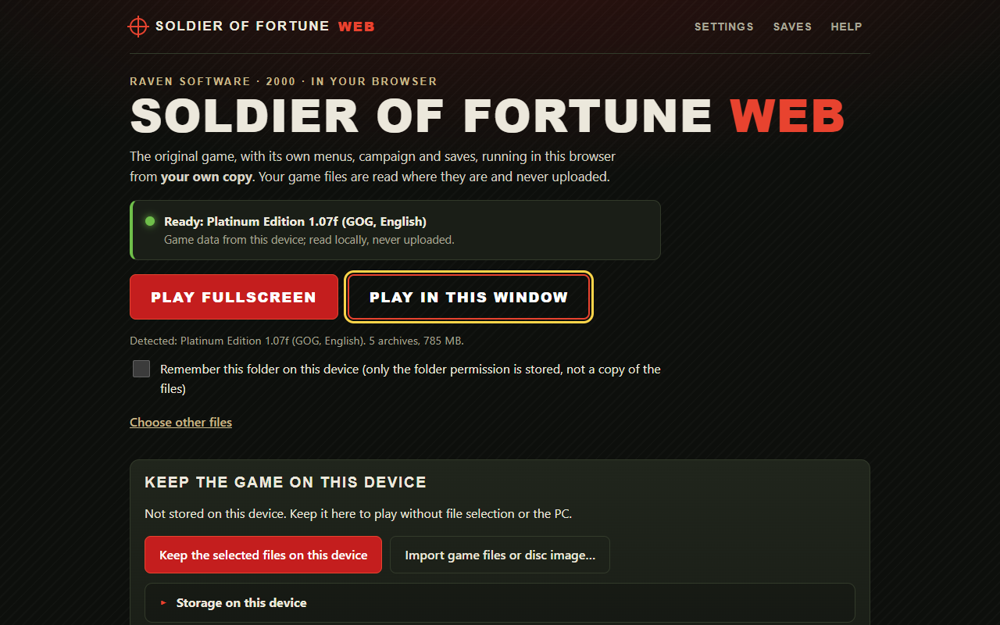
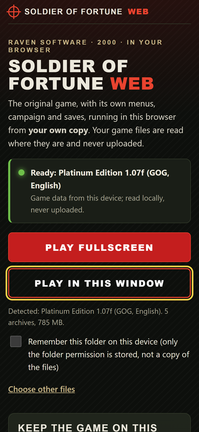

# Setup guide: from zero to playing

This guide takes you from an empty PC to playing Soldier of Fortune in a desktop browser, then on a phone over your
home network, then offline on the phone, and finally in local multiplayer. Each part builds on the previous one; stop
wherever you have what you need.

| Part | You get | Time |
| --- | --- | --- |
| [1. Prerequisites](#1-prerequisites) | the tools and your game data | 20-40 min |
| [2. Build](#2-build-the-engine-and-the-page) | the engine and the startup page | 10-20 min |
| [3. Play on the PC](#3-play-on-the-pc) | the game in desktop Chrome | 5 min |
| [4. Play on a phone](#4-play-on-a-phone-over-your-home-network) | the game on a phone, data streamed from the PC | 20 min |
| [5. Keep the game on the phone](#5-keep-the-game-on-the-phone-offline-play) | single-player without the PC | 10-20 min |
| [6. Controllers and touch](#6-controllers-and-touch) | Bluetooth controller or tuned touch controls | 5 min |
| [7. Multiplayer](#7-local-multiplayer) | browsers playing together on a local server | 20 min |
| [8. Everyday use](#8-everyday-use-updates-saves-and-troubleshooting) | updating, saves, fixing problems | - |

Everything runs on your own machines. Nothing is uploaded, and this project is LAN-only: never forward ports on your
router or put the LAN host on the internet.

## 1. Prerequisites

### Your own copy of the game

You need **Soldier of Fortune Platinum Edition 1.07f**. One of:

| What you have | Status |
| --- | --- |
| The GOG installation (folder with `base/pak0.pak` ... `pak3.pak`, `gs.pak`) | tested, recommended |
| The GOG installer `setup_soldier_of_fortune_1.07f_hotfix_(54919).exe` | tested: the page unpacks it without running it |
| The 2001 Platinum CD image (`.iso`) | tested: the page unpacks it without running it |
| Another 1.07f installation with all five archives | accepted, marked *unverified* |

The game data is about 785 MB. It is never part of this repository, a build or a container image.

### Tools (on the PC that builds and hosts)

Tested on Windows 11 with Git Bash. macOS and Linux use the same commands.

| Tool | Version used | Get it |
| --- | --- | --- |
| Git (with Git Bash on Windows) | any recent | <https://git-scm.com/> |
| Node.js and npm | 24.20 / 11.6 | <https://nodejs.org/> |
| Python | 3.10 or newer | <https://www.python.org/> |
| CMake | 3.20 or newer | <https://cmake.org/> |
| Ninja | any recent | <https://ninja-build.org/> |
| Emscripten SDK | 6.0.13 | below |
| Google Chrome | current | for playing on the PC |
| Docker Desktop | optional | only for part 7 |

Install the Emscripten SDK into a folder of your choice (it does not change system settings):

```sh
git clone https://github.com/emscripten-core/emsdk.git
cd emsdk
./emsdk install 6.0.13
./emsdk activate 6.0.13
source ./emsdk_env.sh      # run this in every new terminal that builds the engine
emcc --version             # should print 6.0.13
```

## 2. Build the engine and the page

```sh
git clone <this repository> sof-web
cd sof-web
npm ci
npm run engine        # needs the activated Emscripten SDK; 10-20 minutes the first time
npm run typecheck
npm test
npm run build         # -> dist/
```

`npm run engine` downloads openMERC v0.2.2 at a pinned commit, applies the patches in `patches/`, and writes the
WebAssembly engine and its modules to `public/engine/`. Details: [BUILD.md](BUILD.md).

`npm run check:dist` inspects the build. It currently ends with **NOT DEPLOYABLE** (exit code 2) because some
third-party material in openMERC has unresolved provenance ([LICENSING.md](LICENSING.md)). That does not stop you from
playing locally; it means the build must not be put on a public website.

## 3. Play on the PC

```sh
npm run preview       # serves dist/ at http://localhost:4173
```

Open <http://localhost:4173> in Chrome.



1. **Choose folder** and pick your Soldier of Fortune folder (or its `base` folder). The files are read where they are.
   Alternatively use **Choose the .pak files**, or drag the folder onto the page.
   Only have the installer or CD image? Use **Keep the game on this device → Import game files or disc image…** and
   select the `.exe` or `.iso`; the page unpacks the five archives into browser storage (about half a minute).
2. The status turns green: **Ready: Platinum Edition 1.07f**. Tick **Remember this folder** to skip this step next
   time.
3. Press **Play fullscreen** (or **Play in this window**). The startup page disappears and the game starts like the
   original: warning screen, intro, main menu. Esc skips the intro.
4. Play with the original keys (WASD, mouse, Space to use, Esc for the menu). Save and load from the game's own menu.
5. **Quit** in the game's main menu returns to the startup page; saves and settings are kept in this browser.

Settings that belong to the browser (display shape and widescreen, frame-rate target, touch layout, controller
calibration, input diagnostics) are under **Settings** on the startup page. The game's own options are in its menus.

## 4. Play on a phone over your home network

The PC serves the page and its own game files; the phone runs the game itself (WebAssembly, not video streaming) and
reads the archives from the PC as needed. Full reference: [LAN.md](LAN.md).

### 4.1 Once on the PC

```sh
npm run lan:cert      # creates server/certs/: a private test CA and an HTTPS certificate for this PC's addresses
```

Allow the port through Windows Firewall for your home network only (PowerShell as administrator; do not turn the
firewall off and do not touch your router):

```powershell
Set-NetConnectionProfile -InterfaceAlias "Wi-Fi" -NetworkCategory Private   # only if this is your own home network
New-NetFirewallRule -DisplayName "SoF LAN host 8443 (testing)" -Direction Inbound -Action Allow -Protocol TCP `
  -LocalPort 8443 -Profile Private -RemoteAddress LocalSubnet
```

Use the name of your network connection (`Get-NetConnectionProfile` lists it; often "Wi-Fi" or "Ethernet").

### 4.2 Start the host

```sh
npm run build
npm run lan -- --data "C:\GOG Games\Soldier of Fortune"
```

The host prints one link per network adapter, like `https://192.168.1.20:8443/?key=…`, and a six-digit
**pairing code**. Use the link of the adapter on your Wi-Fi/Ethernet network (not vEthernet, WSL or VPN). The key and
the code admit a device to your copy: keep them private and do not paste them into bug reports.

A new key and code are made at every start. To keep phones paired across restarts, start with a fixed key of your
own: `SOF_LAN_KEY=<12-64 characters> npm run lan -- --data "…"`.

### 4.3 Once on the phone: trust the certificate

Open the printed link and accept the browser's warning once. Then:

- **iPhone/iPad (Safari):** open `https://<PC address>:8443/lan/ca.crt`, allow the download, then Settings → Profile
  Downloaded → Install, and Settings → General → About → Certificate Trust Settings → turn on full trust for
  "SoF browser port local test CA".
- **Android (Chrome):** open the same address to download it, then Settings → Security → More security settings →
  Encryption & credentials → Install a certificate → CA certificate → `sof-lan-ca.crt`.

HTTPS is needed: controllers, the installed app and offline storage only work in a secure context.

### 4.4 Install the app and pair



- **iPhone/iPad:** in Safari, open the tester link → Share → **Add to Home Screen** (keep "Open as Web App" on) →
  open **Soldier of Fortune Web** from the Home Screen. On iOS, play happens in the installed app, not in the
  Safari tab.
- **Android:** press **Install app** on the startup page (or browser menu → Install app), or choose
  **Continue in browser**.

The installed app opens without the key, so its first start shows **Pair this device**: type the pairing code from
the PC's window. It then shows **Ready … served by your PC** with no file picker. Turn the phone sideways and press
**Play**; gameplay is landscape only (rotating to portrait pauses single-player).

Saves on the phone stay on the phone. The PC's own Soldier of Fortune saves are never touched.

## 5. Keep the game on the phone (offline play)

On the paired phone, startup page → **Keep the game on this device** → **Download and keep the game from my PC**.
About 785 MB; keep the app open and the screen on. An interrupted download resumes where it stopped. When the status
says **Ready on this device**, the app starts single-player without the PC, without pairing and with the network
off. Without a PC, **Import game files or disc image…** does the same from files on the phone (the five `.pak` files,
the GOG installer or the CD image).

- **Storage on this device** shows the space used and whether the browser keeps it persistently.
- **Verify stored game data** re-checks every archive; **Remove game data** frees the space and keeps your saves.
- Storage belongs to one address: if the PC's LAN address changes, the app at the new address starts empty. Export
  your saves first and import them there (part 8). Giving the PC a fixed address in your router's DHCP settings
  avoids this.

Details: [INSTALL_ON_DEVICE.md](INSTALL_ON_DEVICE.md).

## 6. Controllers and touch

- **Controller** (tested with a Bluetooth MCON on iPhone; others with a standard layout should work): connect it to
  the phone or PC, press a button, and play. Left stick moves, right stick looks, right trigger fires, A jumps,
  B crouches, X uses, shoulders switch weapons, Start opens the game menu. The touch controls hide once controller
  input reaches the game and come back if it disconnects.
- **Touch:** left thumb moves (analog), dragging on the right side looks, Fire can be dragged to aim. Size, opacity,
  position, left-handed layout and look speed are under Settings → **Controls: input mode and touch**.
- **Speeds:** Settings → **Controller** sets turn rates, dead zone and response curve. **Reset** restores the
  recommended defaults.
- **Not working?** Settings → **Input diagnostics** shows what the browser reports and what reaches the game, and
  **Copy report** gives a text you can share (access keys are removed automatically).

All mappings: [CONTROLS.md](CONTROLS.md).

## 7. Local multiplayer

Browsers join a native openMERC dedicated server through a WebSocket-to-UDP gateway in the LAN host. With Docker:

```sh
cd server
SOF_DATA="C:/GOG Games/Soldier of Fortune/base" SOF_PUBLIC_IP=192.168.1.20 SOF_BIND=192.168.1.20 docker compose up --build
```

Use your PC's LAN address for both variables. The game data is mounted read-only; the tester link and key are in
`docker compose logs web`. In the game: Multiplayer → Join → Refresh → select the server → Connect.

There is no internet server list, and **Start Server** in a browser only hosts for the local player; use the dedicated
server instead. Details, tested results and running without Docker: [MULTIPLAYER.md](MULTIPLAYER.md).

## 8. Everyday use: updates, saves and troubleshooting

### Updating

```sh
git pull
npm ci
npm run engine        # only when patches/ changed
npm run build
```

Restart `npm run lan` if it was running. An installed app downloads the new version in the background and uses it at
its next start (sometimes one more start). Settings → **Game session reports** shows the running versions; they should
end in "(same as this page)". Saves and stored game data are kept across updates.

### Saves

- Saving and loading use the game's own menu. Saves and settings live in the browser of each device, per address.
- **Saves and storage → Export saves** writes a backup file; **Import saves** reads it on another browser or device.
  Nothing synchronises automatically.
- **Delete settings and saves** removes them; removing game data never does.

### When something goes wrong

| Problem | What to do |
| --- | --- |
| The game froze or closed | Reload or reopen the app. If the startup page says the last session did not end normally, press **Copy report** and include the text in your bug report. |
| Phone: "This connection is not private" | Install and trust the certificate (4.3). After the PC's address changes, run `npm run lan:cert` again and restart the host. |
| Phone cannot reach the PC | Same Wi-Fi as the PC? Firewall rule added (4.1)? Correct adapter link? |
| Installed app asks to pair again | The host was restarted with a new random key. Use a fixed `SOF_LAN_KEY`. |
| Controller does nothing | Settings → Input diagnostics; press a button after connecting. Copy the report. |
| Tab closes on an older phone | Memory: the game needs roughly 600 MB plus graphics. Close other apps; keeping the game on the device does not reduce this. |
| `check:dist` says NOT DEPLOYABLE | Expected for now; see [LICENSING.md](LICENSING.md). Do not publish the build. |

What is verified and what is not, including known open bugs: [STATUS.md](STATUS.md).
